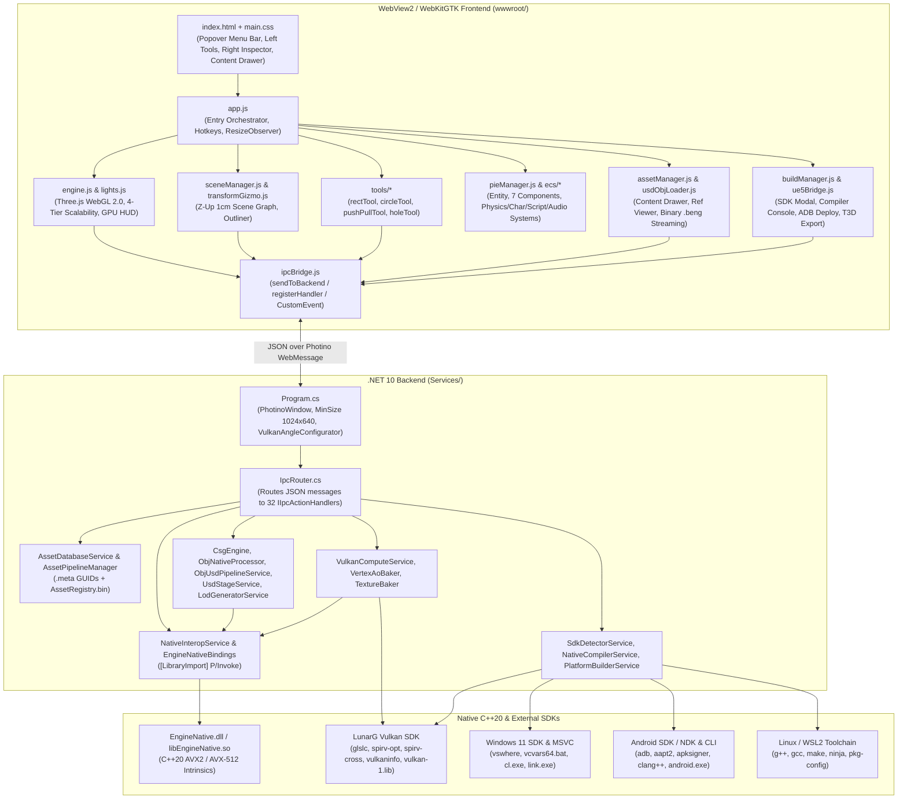

# UE5 Blockout Studio — Technical Reference & Architecture Guide

This document provides a complete engineering reference of **UE5 Blockout Studio** (`UE5BlockoutStudio`), detailing its classes, interfaces, functions, IPC message contracts, Native C++20 ABI, frontend ES6 modules, binary formats, and external SDK integrations. It is intended for engineers implementing new features, performing maintenance, or diagnosing bugs.

---

## Table of Contents
1. [System Architecture & Lifecycle](#1-system-architecture--lifecycle)
2. [Backend C# Services & Classes (`Services/`)](#2-backend-c-services--classes-services)
   - [2.1 Hosting & Dependency Injection](#21-hosting--dependency-injection)
   - [2.2 IPC Router & All 32 Action Handlers](#22-ipc-router--all-32-action-handlers)
   - [2.3 Hybrid Asset Database & Pipelines (`Services/Assets/`)](#23-hybrid-asset-database--pipelines-servicesassets)
   - [2.4 Geometry, CSG, `.OBJ` & `.USD` Stage Services (`Services/Geometry/`)](#24-geometry-csg-obj--usd-stage-services-servicesgeometry)
   - [2.5 Graphics, Vulkan Compute & Bakers (`Services/Graphics/`)](#25-graphics-vulkan-compute--bakers-servicesgraphics)
   - [2.6 Build Pipeline, SDK Probing & Native Compiler (`Services/BuildPipeline/`)](#26-build-pipeline-sdk-probing--native-compiler-servicesbuildpipeline)
   - [2.7 Project Storage & UE5 T3D Clipboard (`Services/`)](#27-project-storage--ue5-t3d-clipboard-services)
3. [Native C++20 Core (`Native/EngineNative/` & `Services/NativeInterop/`)](#3-native-c20-core-nativeenginenative--servicesnativeinterop)
4. [Frontend ES6 Module Architecture (`wwwroot/js/`)](#4-frontend-es6-module-architecture-wwwrootjs)
5. [External SDK Integrations & Command Pipelines](#5-external-sdk-integrations--command-pipelines)
6. [Binary & File Format Specifications](#6-binary--file-format-specifications)
7. [Developer Playbooks: Adding Features, Debugging & Running Tests](#7-developer-playbooks-adding-features-debugging--running-tests)

---

## 1. System Architecture & Lifecycle



---

## 2. Backend C# Services & Classes (`Services/`)

### 2.1 Hosting & Dependency Injection

| Class / File | Responsibility | Key Methods |
| :--- | :--- | :--- |
| [`Program`](file:///D:/Rodrigo/Documents/Dev/vscode/Desktop/dotNET/Blockout_Studio/Program.cs) | Main entry point (`[STAThread]`). Runs `AutomatedTests.RunAllTests()` if `--test` is passed; otherwise configures ANGLE flags, builds the DI container, creates `PhotinoWindow` (`1440×900`, `.SetMinSize(1024, 640)`), and attaches `ipcRouter.DispatchAsync`. | `Main(string[] args)` |
| [`ServiceRegistration`](file:///D:/Rodrigo/Documents/Dev/vscode/Desktop/dotNET/Blockout_Studio/Services/ServiceRegistration.cs) | Registers all 12 core interfaces, 9 dual-mapped concrete singletons, 32 `IIpcActionHandler` implementations, and `IIpcRouter`. | `AddEngineServices(this IServiceCollection)`, `BuildEngineServiceProvider()` |
| [`VulkanAngleConfigurator`](file:///D:/Rodrigo/Documents/Dev/vscode/Desktop/dotNET/Blockout_Studio/Services/Hosting/VulkanAngleConfigurator.cs) | Probes host GPU and configures WebView2 Chromium browser flags (`WEBVIEW2_ADDITIONAL_BROWSER_ARGUMENTS`). Defaults Windows to `--use-angle=d3d11` to prevent hybrid Optimus GPU swapchain crashes unless `FORCE_VULKAN_ANGLE=1` or `--vulkan-angle` is specified. | `ConfigureWebViewEnvironment(string[]? args)`, `IsVulkanRuntimeAvailable()` |

---

### 2.2 IPC Router & All 32 Action Handlers

All communication between JavaScript and C# passes through [`IpcRouter`](file:///D:/Rodrigo/Documents/Dev/vscode/Desktop/dotNET/Blockout_Studio/Services/Ipc/IpcRouter.cs), which maps `root.GetProperty("action").GetString()` to an `IReadOnlyDictionary<string, IIpcActionHandler>` (case-insensitive).

| IPC `action` Request | Response `action` | Handler Class & File | Purpose |
| :--- | :--- | :--- | :--- |
| `copy_ue5` | `copy_ue5_response` | [`CopyUe5Handler`](file:///D:/Rodrigo/Documents/Dev/vscode/Desktop/dotNET/Blockout_Studio/Services/Ipc/Handlers/CopyUe5Handler.cs) | Generates UE5 `.t3d` text from scene blocks/lights and copies to OS clipboard via `TextCopy`. |
| `csg_cut` | `csg_cut_response` | [`CsgCutHandler`](file:///D:/Rodrigo/Documents/Dev/vscode/Desktop/dotNET/Blockout_Studio/Services/Ipc/Handlers/CsgCutHandler.cs) | Executes 3D CSG boolean subtraction (`rect`, `circle`, `arch`, through or blind depth) via `ICsgEngine`. |
| `bake_ao` | `bake_ao_response` | [`BakeAoHandler`](file:///D:/Rodrigo/Documents/Dev/vscode/Desktop/dotNET/Blockout_Studio/Services/Ipc/Handlers/BakeAoHandler.cs) | Computes per-vertex Ambient Occlusion colors via Vulkan Compute, C++20 AVX2, or C# SIMD. |
| `get_grid_texture` | `grid_texture_response` | [`GetGridTextureHandler`](file:///D:/Rodrigo/Documents/Dev/vscode/Desktop/dotNET/Blockout_Studio/Services/Ipc/Handlers/GetGridTextureHandler.cs) | Generates a Base64 PNG metric grid texture tinted to a hex color via `TextureBaker`. |
| `save_project` | `save_project_response` | [`SaveProjectHandler`](file:///D:/Rodrigo/Documents/Dev/vscode/Desktop/dotNET/Blockout_Studio/Services/Ipc/Handlers/SaveProjectHandler.cs) | Saves level JSON via native OS Save File dialog (`IProjectStorageService`). |
| `load_project` | `load_project_response` | [`LoadProjectHandler`](file:///D:/Rodrigo/Documents/Dev/vscode/Desktop/dotNET/Blockout_Studio/Services/Ipc/Handlers/LoadProjectHandler.cs) | Loads level JSON via native OS Open File dialog (`IProjectStorageService`). |
| `query_toolchains` | `toolchains_response` | [`ToolchainIpcHandler`](file:///D:/Rodrigo/Documents/Dev/vscode/Desktop/dotNET/Blockout_Studio/Services/Ipc/Handlers/ToolchainIpcHandler.cs) | Probes Vulkan, MSVC, Android, and GCC toolchains (`IToolchainDiscoveryService`). |
| `export_usd` | `export_usd_response` | [`ExportUsdHandler`](file:///D:/Rodrigo/Documents/Dev/vscode/Desktop/dotNET/Blockout_Studio/Services/Ipc/Handlers/ExportUsdHandler.cs) | Exports scene actors to an external `.usda` stage file (`IUsdStageService`). |
| `export_obj` | `export_obj_response` | [`ExportObjHandler`](file:///D:/Rodrigo/Documents/Dev/vscode/Desktop/dotNET/Blockout_Studio/Services/Ipc/Handlers/ExportObjHandler.cs) | Exports scene actors to Wavefront `.obj` + `.mtl`. |
| `get_native_status` | `native_status_response` | [`GetNativeStatusHandler`](file:///D:/Rodrigo/Documents/Dev/vscode/Desktop/dotNET/Blockout_Studio/Services/Ipc/Handlers/GetNativeStatusHandler.cs) | Reports `EngineNative.dll` load status, version, and CPU SIMD capabilities (`SSE4.1`, `AVX2`, `AVX-512`). |
| `create_project` | `project_status_response` | [`CreateProjectHandler`](file:///D:/Rodrigo/Documents/Dev/vscode/Desktop/dotNET/Blockout_Studio/Services/Ipc/Handlers/CreateProjectHandler.cs) | Scaffolds a new project workspace (`Assets/`, `Library/`, `ProjectSettings/`, starter scripts & C++ plugin). |
| `open_project` | `project_status_response` | [`OpenProjectHandler`](file:///D:/Rodrigo/Documents/Dev/vscode/Desktop/dotNET/Blockout_Studio/Services/Ipc/Handlers/OpenProjectHandler.cs) | Opens an existing project folder and indexes its `AssetRegistry.bin`. |
| `get_project_status` | `project_status_response` | [`GetProjectStatusHandler`](file:///D:/Rodrigo/Documents/Dev/vscode/Desktop/dotNET/Blockout_Studio/Services/Ipc/Handlers/GetProjectStatusHandler.cs) | Returns active project manifest, root path, folders, and asset registry snapshot. |
| `get_asset_registry` | `asset_registry_response` | [`GetAssetRegistryHandler`](file:///D:/Rodrigo/Documents/Dev/vscode/Desktop/dotNET/Blockout_Studio/Services/Ipc/Handlers/GetAssetRegistryHandler.cs) | Scans project `Assets/` directory and returns all `AssetRegistryItem` entries and folders. |
| `import_asset` | `import_asset_response` | [`ImportAssetHandler`](file:///D:/Rodrigo/Documents/Dev/vscode/Desktop/dotNET/Blockout_Studio/Services/Ipc/Handlers/ImportAssetHandler.cs) | Copies an external file into `Assets/<TargetFolder>/`, generates `.meta`, and runs import pipelines. |
| `reimport_asset` | `reimport_asset_response` | [`ReimportAssetHandler`](file:///D:/Rodrigo/Documents/Dev/vscode/Desktop/dotNET/Blockout_Studio/Services/Ipc/Handlers/ReimportAssetHandler.cs) | Re-runs `ObjUsdPipelineService` and invalidates/rebuilds the `.beng` cache for a given GUID. |
| `delete_asset` | `delete_asset_response` | [`DeleteAssetHandler`](file:///D:/Rodrigo/Documents/Dev/vscode/Desktop/dotNET/Blockout_Studio/Services/Ipc/Handlers/DeleteAssetHandler.cs) | Deletes an asset file, its `.meta` sidecar, and its `.beng` artifact cache. |
| `show_in_explorer` | `show_in_explorer_response` | [`ShowInExplorerHandler`](file:///D:/Rodrigo/Documents/Dev/vscode/Desktop/dotNET/Blockout_Studio/Services/Ipc/Handlers/ShowInExplorerHandler.cs) | Opens Windows Explorer / OS file manager highlighting the asset on disk. |
| `get_asset_content` | `asset_content_response` | [`GetAssetContentHandler`](file:///D:/Rodrigo/Documents/Dev/vscode/Desktop/dotNET/Blockout_Studio/Services/Ipc/Handlers/GetAssetContentHandler.cs) | Reads raw text/script content of an asset (`Assets/Scripts/*.js`) for runtime execution in PIE. |
| `load_mesh_binary` | `load_mesh_binary_response` | [`LoadMeshBinaryHandler`](file:///D:/Rodrigo/Documents/Dev/vscode/Desktop/dotNET/Blockout_Studio/Services/Ipc/Handlers/LoadMeshBinaryHandler.cs) | Compiles/loads a `.obj` or `.usd` asset into a Base64-encoded `.beng` binary buffer for Three.js. |
| `save_blockout_as_obj` | `save_blockout_as_obj_response` | [`SaveBlockoutAsObjHandler`](file:///D:/Rodrigo/Documents/Dev/vscode/Desktop/dotNET/Blockout_Studio/Services/Ipc/Handlers/SaveBlockoutAsObjHandler.cs) | Saves a viewport blockout or CSG mesh into `Assets/Meshes/<name>.obj` with baked Vertex AO colors and `.beng` cache. |
| `save_usd_stage` | `save_usd_stage_response` | [`SaveUsdStageHandler`](file:///D:/Rodrigo/Documents/Dev/vscode/Desktop/dotNET/Blockout_Studio/Services/Ipc/Handlers/SaveUsdStageHandler.cs) | Writes a `.usda` stage to `Assets/Levels/<name>.usda` along with non-destructive `over` delta layers. |
| `compile_shader` | `compile_shader_response` | [`CompileShaderHandler`](file:///D:/Rodrigo/Documents/Dev/vscode/Desktop/dotNET/Blockout_Studio/Services/Ipc/Handlers/CompileShaderHandler.cs) | Compiles GLSL source via `glslc` $\rightarrow$ `spirv-opt` $\rightarrow$ `spirv-cross` into WebGL 2.0 GLSL ES 3.00. |
| `generate_lods` | `generate_lods_response` | [`GenerateLodsHandler`](file:///D:/Rodrigo/Documents/Dev/vscode/Desktop/dotNET/Blockout_Studio/Services/Ipc/Handlers/GenerateLodsHandler.cs) | Generates `LOD0` (`100%`), `LOD1` (`50%`), and `LOD2` (`20%`) meshes via vertex clustering (`ILodGeneratorService`). |
| `set_scalability_tier` | `scalability_tiers_response` | [`ScalabilityTierHandler`](file:///D:/Rodrigo/Documents/Dev/vscode/Desktop/dotNET/Blockout_Studio/Services/Ipc/Handlers/ScalabilityTierHandler.cs) | Persists active scalability tier (`0`–`3`) to `ProjectSettings/QualityTiers.json`. |
| `get_scalability_tiers` | `scalability_tiers_response` | [`GetScalabilityTiersHandler`](file:///D:/Rodrigo/Documents/Dev/vscode/Desktop/dotNET/Blockout_Studio/Services/Ipc/Handlers/ScalabilityTierHandler.cs) | Loads scalability presets from `ProjectSettings/QualityTiers.json`. |
| `get_sdk_status` | `sdk_status_response` | [`GetSdkStatusHandler`](file:///D:/Rodrigo/Documents/Dev/vscode/Desktop/dotNET/Blockout_Studio/Services/Ipc/Handlers/SdkBuildHandlers.cs) | Runs `ISdkDetectorService.DetectAllSdksAsync()` for Vulkan, Windows/MSVC, Linux/GCC, and Android/NDK. |
| `set_sdk_paths` | `sdk_status_response` | [`SetSdkPathsHandler`](file:///D:/Rodrigo/Documents/Dev/vscode/Desktop/dotNET/Blockout_Studio/Services/Ipc/Handlers/SdkBuildHandlers.cs) | Saves custom SDK paths to `ProjectSettings/SDKPaths.json` and re-probes all toolchains. |
| `compile_native_module` | `compile_native_module_response` | [`CompileNativeModuleHandler`](file:///D:/Rodrigo/Documents/Dev/vscode/Desktop/dotNET/Blockout_Studio/Services/Ipc/Handlers/SdkBuildHandlers.cs) | Compiles C++20 plugins in `Assets/NativePlugins/` via `cl.exe` or `g++` and streams `compiler_log` events. |
| `build_project` | `build_project_response` | [`BuildProjectHandler`](file:///D:/Rodrigo/Documents/Dev/vscode/Desktop/dotNET/Blockout_Studio/Services/Ipc/Handlers/SdkBuildHandlers.cs) | Cooks shaders/meshes and stages standalone Windows, Linux, or Android APK builds (`IPlatformBuilderService`). |
| `get_adb_devices` | `adb_devices_response` | [`GetAdbDevicesHandler`](file:///D:/Rodrigo/Documents/Dev/vscode/Desktop/dotNET/Blockout_Studio/Services/Ipc/Handlers/SdkBuildHandlers.cs) | Queries `adb devices -l` and returns connected Android device serials, models, and statuses. |
| `deploy_to_device` | `deploy_to_device_response` | [`DeployToDeviceHandler`](file:///D:/Rodrigo/Documents/Dev/vscode/Desktop/dotNET/Blockout_Studio/Services/Ipc/Handlers/SdkBuildHandlers.cs) | Installs staged APK via `adb -s <serial> install -r` and launches the Android activity. |

---

### 2.3 Hybrid Asset Database & Pipelines (`Services/Assets/`)

- **[`IAssetDatabaseService`](file:///D:/Rodrigo/Documents/Dev/vscode/Desktop/dotNET/Blockout_Studio/Services/Assets/IAssetDatabaseService.cs) / [`AssetDatabaseService`](file:///D:/Rodrigo/Documents/Dev/vscode/Desktop/dotNET/Blockout_Studio/Services/Assets/AssetDatabaseService.cs)**:
  - Manages project lifecycle (`CreateProject`, `OpenProject`, `EnsureDefaultProjectInitialized`).
  - Scaffolds the standard 13-folder project hierarchy:
    - `Assets/Meshes`, `Assets/Materials`, `Assets/Textures`, `Assets/Levels`, `Assets/Prefabs`, `Assets/Audio`, `Assets/Scripts`, `Assets/Shaders`, `Assets/NativePlugins`
    - `Library/ArtifactCache`, `ProjectSettings`, `Saved/Autosaves`, `Saved/Logs`
  - Generates deterministic `.meta` sidecar files ([`AssetMeta.cs`](file:///D:/Rodrigo/Documents/Dev/vscode/Desktop/dotNET/Blockout_Studio/Services/Assets/AssetMeta.cs)) containing a 32-character hex `Guid`, `AssetType`, `ImporterSettings`, and `Dependencies`.
  - Serializes the fast lookup index to `Library/AssetRegistry.bin` ([`AssetRegistryItem.cs`](file:///D:/Rodrigo/Documents/Dev/vscode/Desktop/dotNET/Blockout_Studio/Services/Assets/AssetRegistryItem.cs)) with virtual UE5-style paths (`/Game/Meshes/...`).

---

### 2.4 Geometry, CSG, `.OBJ` & `.USD` Stage Services (`Services/Geometry/`)

- **[`ICsgEngine`](file:///D:/Rodrigo/Documents/Dev/vscode/Desktop/dotNET/Blockout_Studio/Services/Geometry/ICsgEngine.cs) / [`CsgEngine`](file:///D:/Rodrigo/Documents/Dev/vscode/Desktop/dotNET/Blockout_Studio/Services/Geometry/CsgEngine.cs)**:
  - Performs exact 2D-profile extrude & 3D Pocket Boolean Subtraction (`SubtractHole`) on box/wall meshes.
  - Supports **Through-All Cuts** and **Blind Pockets/Recesses** along auto-detected or explicit axes (`X`, `Y`, `Z`), generating watertight outer/inner wall loops, jambs, sills, headers, and pocket back-caps with proper planar UV mapping.
- **[`ObjNativeProcessor`](file:///D:/Rodrigo/Documents/Dev/vscode/Desktop/dotNET/Blockout_Studio/Services/Geometry/ObjNativeProcessor.cs)**:
  - Zero-allocation `Span<T>` Wavefront `.obj` and `.mtl` parser and exporter.
  - Supports extended vertex lines with baked RGB vertex colors (`v x y z r g b`), fan triangulation for N-gons, smooth normal calculation, pivot realignment (`BottomCenter` vs `WorldOrigin`), and axis conversion (`Z-Up` vs `Y-Up`).
- **[`IObjUsdPipelineService`](file:///D:/Rodrigo/Documents/Dev/vscode/Desktop/dotNET/Blockout_Studio/Services/Geometry/ObjUsdPipelineService.cs) / [`ObjUsdPipelineService`](file:///D:/Rodrigo/Documents/Dev/vscode/Desktop/dotNET/Blockout_Studio/Services/Geometry/ObjUsdPipelineService.cs)**:
  - Compiles `.obj` and `.usd` assets into flat binary `.beng` buffers in `Library/ArtifactCache/<guid>.beng` (`CompileAndCacheMesh`, `SaveBlockoutMeshAsObjAsset`).
- **[`IUsdStageService`](file:///D:/Rodrigo/Documents/Dev/vscode/Desktop/dotNET/Blockout_Studio/Services/Geometry/IUsdStageService.cs) / [`UsdStageService`](file:///D:/Rodrigo/Documents/Dev/vscode/Desktop/dotNET/Blockout_Studio/Services/Geometry/UsdStageService.cs)**:
  - Reads and writes ASCII `.usda` stages (`#usda 1.0`) with `upAxis = "Z"` and `metersPerUnit = 0.01`.
  - Supports `subLayers`, `prepend references`, `prepend payload`, `variantSets = ["LOD"]` (`HighPoly_PC` / `LowPoly_Mobile`), and non-destructive **`over` opinions** (`WriteOverOpinion`, `ApplyOverOpinionsToStage`) so level-specific transform or material overrides never mutate source asset files.
- **[`ILodGeneratorService`](file:///D:/Rodrigo/Documents/Dev/vscode/Desktop/dotNET/Blockout_Studio/Services/Geometry/ILodGeneratorService.cs) / [`LodGeneratorService`](file:///D:/Rodrigo/Documents/Dev/vscode/Desktop/dotNET/Blockout_Studio/Services/Geometry/LodGeneratorService.cs)**:
  - Spatial grid vertex-clustering mesh simplifier that generates `LOD0` (`100%`), `LOD1` (`~50%`), and `LOD2` (`~20%`) triangle index/vertex buffers while preserving boundary silhouettes and normals.

---

### 2.5 Graphics, Vulkan Compute & Bakers (`Services/Graphics/`)

- **[`IVulkanComputeService`](file:///D:/Rodrigo/Documents/Dev/vscode/Desktop/dotNET/Blockout_Studio/Services/Graphics/IVulkanComputeService.cs) / [`VulkanComputeService`](file:///D:/Rodrigo/Documents/Dev/vscode/Desktop/dotNET/Blockout_Studio/Services/Graphics/VulkanComputeService.cs)**:
  - Integrates the LunarG **Vulkan SDK**:
    - Compiles `.vert`, `.frag`, and `.comp` GLSL shaders into SPIR-V (`.spv`) using `glslc` or `glslangValidator`.
    - Optimizes SPIR-V bytecode with `spirv-opt -O`.
    - Transpiles SPIR-V into **WebGL 2.0 GLSL ES 3.00** (`--version 300 --es`) using `spirv-cross`.
    - Executes ray-marched Ambient Occlusion (`ComputeVertexAoGpu`) via compiled Vulkan compute shaders (`VertexAoCompute.comp.spv`) with automatic fallback to C++20 AVX2 or C# `Parallel.For` SIMD.
- **[`VertexAoBaker`](file:///D:/Rodrigo/Documents/Dev/vscode/Desktop/dotNET/Blockout_Studio/Services/Graphics/VertexAoBaker.cs)**:
  - Fibonacci hemisphere ray-marched Ambient Occlusion baker (`32` rays per vertex, `250 cm` occlusion radius).
  - 3-tier execution path: **Vulkan Compute (SPIR-V GPU)** $\rightarrow$ **Native C++20 AVX2/AVX-512 (`EngineNative.dll`)** $\rightarrow$ **Managed C# `Parallel.For` + `System.Numerics.Vector3` SIMD**.
- **[`TextureBaker`](file:///D:/Rodrigo/Documents/Dev/vscode/Desktop/dotNET/Blockout_Studio/Services/Graphics/TextureBaker.cs)**:
  - Generates `256×256` RGBA procedural UE5 metric grid textures with major borders, `64px` sub-grids, center crosshairs, and corner studs, encoded as PNG data URLs (`GenerateGridPngBase64`).

---

### 2.6 Build Pipeline, SDK Probing & Native Compiler (`Services/BuildPipeline/`)

- **[`ISdkDetectorService`](file:///D:/Rodrigo/Documents/Dev/vscode/Desktop/dotNET/Blockout_Studio/Services/BuildPipeline/ISdkDetectorService.cs) / [`SdkDetectorService`](file:///D:/Rodrigo/Documents/Dev/vscode/Desktop/dotNET/Blockout_Studio/Services/BuildPipeline/SdkDetectorService.cs)**:
  - Probes 4 native SDK families and persists custom user overrides in `<ProjectRoot>/ProjectSettings/SDKPaths.json`:
    1. **Vulkan SDK (`DetectVulkanSdkAsync`)**: Checks custom path, `VULKAN_SDK`, and `C:\VulkanSDK\<ver>`; verifies `glslc`, `glslangValidator`, `spirv-opt`, `spirv-cross`, `vulkaninfo`, `Include/vulkan/vulkan.h`, and `Lib/vulkan-1.lib`.
    2. **Windows 11 SDK & MSVC (`DetectWindowsMsvcAsync`)**: Queries registry `HKLM\SOFTWARE\Microsoft\Windows Kits\Installed Roots\KitsRoot10` for `rc.exe` and `signtool.exe`, and executes `vswhere.exe` to locate `vcvars64.bat`, `cl.exe`, `link.exe`, and `nmake.exe`.
    3. **Linux GCC/G++ (`DetectLinuxGccAsync`)**: Probes native Linux or Windows WSL2 (`wsl --status`) for `g++`, `gcc`, `make`, `ninja`, and `pkg-config`.
    4. **Android SDK, NDK & ADB (`DetectAndroidSdkAsync` & `GetConnectedAdbDevicesAsync`)**: Validates `platform-tools/adb`, `build-tools/<ver>/aapt2`, `apksigner`, `platforms/android-<api>`, NDK `clang++`, and `android` CLI, and parses `adb devices -l`.
- **[`INativeCompilerService`](file:///D:/Rodrigo/Documents/Dev/vscode/Desktop/dotNET/Blockout_Studio/Services/BuildPipeline/INativeCompilerService.cs) / [`NativeCompilerService`](file:///D:/Rodrigo/Documents/Dev/vscode/Desktop/dotNET/Blockout_Studio/Services/BuildPipeline/NativeCompilerService.cs)**:
  - Compiles `.cpp` plugins in `<ProjectRoot>/Assets/NativePlugins/` into `<ProjectRoot>/Binaries/Win64/GameNative.dll` (via `vcvars64.bat` + `cl.exe /std:c++20 /O2 /Oi /GL /arch:AVX2 /LD`) or `<ProjectRoot>/Binaries/Linux64/libGameNative.so` (via `g++ -std=c++20 -O3 -march=x86-64-v3 -fPIC -shared`), linking against Vulkan headers and `vulkan-1.lib` when present.
  - Parses compiler stdout/stderr with regex (`^(?<file>.+?)\((?<line>\d+)(?:,(?<col>\d+))?\)\s*:\s*(?<sev>fatal error|error|warning)\s+(?<code>\w+)\s*:\s*(?<msg>.+)$`) into structured `CompilerDiagnostic` objects.
- **[`IPlatformBuilderService`](file:///D:/Rodrigo/Documents/Dev/vscode/Desktop/dotNET/Blockout_Studio/Services/BuildPipeline/IPlatformBuilderService.cs) / [`PlatformBuilderService`](file:///D:/Rodrigo/Documents/Dev/vscode/Desktop/dotNET/Blockout_Studio/Services/BuildPipeline/PlatformBuilderService.cs)**:
  - Cooks SPIR-V shaders and `.beng` binary meshes, writes `PackageManifest.json`, and stages standalone builds into `<ProjectRoot>/Saved/StagedBuilds/{Windows|Linux|Android}/`.
  - Implements `DeployAndroidApkAsync` (`adb -s <serial> install -r <apk>` + `adb shell am start`).

---

### 2.7 Project Storage & UE5 T3D Clipboard (`Services/`)

- **[`Ue5ClipboardService`](file:///D:/Rodrigo/Documents/Dev/vscode/Desktop/dotNET/Blockout_Studio/Services/Ue5ClipboardService.cs)**:
  - Translates editor blocks (`box`, `cylinder`, `sphere`, `ramp`) and lights (`point`, `spot`, `directional` with `Static`/`Stationary`/`Movable` mobility) into Unreal Engine 5 `.t3d` clipboard text (`Begin Map / Begin Level / Begin Actor Class=/Script/Engine.StaticMeshActor ...`).
- **[`IProjectStorageService`](file:///D:/Rodrigo/Documents/Dev/vscode/Desktop/dotNET/Blockout_Studio/Services/IProjectStorageService.cs) / [`ProjectStorageService`](file:///D:/Rodrigo/Documents/Dev/vscode/Desktop/dotNET/Blockout_Studio/Services/ProjectStorageService.cs)**:
  - Handles native OS Save/Load file dialogs via `PhotinoWindow.ShowSaveFile` and `ShowOpenFile`.

---

## 3. Native C++20 Core (`Native/EngineNative/` & `Services/NativeInterop/`)

To maximize geometry and raytracing throughput, UE5 Blockout Studio includes a native C++20 shared library (`Native/EngineNative/src/EngineNative.cpp`, header `include/EngineNative.h`) compiled via `build_msvc.cmd` into `EngineNative.dll` (copied to the output directory next to `UE5BlockoutStudio.exe`).

### Exported C ABI Functions (`EngineNativeBindings.cs`)
Bound in [`EngineNativeBindings`](file:///D:/Rodrigo/Documents/Dev/vscode/Desktop/dotNET/Blockout_Studio/Services/NativeInterop/EngineNativeBindings.cs) using .NET 10 source-generated `[LibraryImport("EngineNative")]` with `[SuppressGCTransition]` where appropriate:

| Exported C Function | Signature | Description |
| :--- | :--- | :--- |
| `EngineNative_GetVersion` | `int EngineNative_GetVersion()` | Returns ABI version (`100` = `v1.0.0`). |
| `EngineNative_GetSimdCapabilities` | `int EngineNative_GetSimdCapabilities()` | Returns bitmask of active hardware intrinsics (`1 = SSE4.1`, `2 = AVX2`, `4 = AVX-512`). |
| `EngineNative_BakeVertexAo` | `int EngineNative_BakeVertexAo(const float* targetPos, const float* targetNorm, int vertexCount, const float* sceneTris, int totalTriCount, int raysPerVertex, float maxDist, float* outColors)` | AVX2-accelerated Möller–Trumbore ray-triangle Ambient Occlusion baker across all scene triangles. |
| `EngineNative_BakeGridTexture` | `int EngineNative_BakeGridTexture(int size, uint8_t r, uint8_t g, uint8_t b, uint8_t* outRgbaPixels)` | Fast native RGBA pixel buffer generator for procedural metric grid textures. |

---

## 4. Frontend ES6 Module Architecture (`wwwroot/js/`)

All frontend modules reside in `wwwroot/js/` and are loaded in strict topological order in [`wwwroot/index.html`](file:///D:/Rodrigo/Documents/Dev/vscode/Desktop/dotNET/Blockout_Studio/wwwroot/index.html#L497-L506):

| Module File | Key Exports & Responsibilities |
| :--- | :--- |
| [`ipcBridge.js`](file:///D:/Rodrigo/Documents/Dev/vscode/Desktop/dotNET/Blockout_Studio/wwwroot/js/ipcBridge.js) | `sendToBackend(payload)`, `sendIpcMessage(payload)`, `registerHandler(action, fn)`, `showToast(msg, isError)`. Bridges `window.external.sendMessage` / `receiveMessage` and dispatches `CustomEvent('ipc-message')`. |
| [`engine.js`](file:///D:/Rodrigo/Documents/Dev/vscode/Desktop/dotNET/Blockout_Studio/wwwroot/js/engine.js) | Initializes `THREE.Scene` (`Z-Up`), `PerspectiveCamera`, `WebGLRenderer`, `OrbitControls`, `SCALABILITY_TIERS` (`0`–`3`), `setScalabilityTier()`, `rebuildInstancedBatches()`, `createAutoLodObject()`, `toggleGpuHud()`, `updateGpuHud()`, and the `180 cm` UE5 Mannequin mesh. |
| [`transformGizmo.js`](file:///D:/Rodrigo/Documents/Dev/vscode/Desktop/dotNET/Blockout_Studio/wwwroot/js/transformGizmo.js) | Configures `THREE.TransformControls`, grid/rotation snapping (`updateSnapSize`), live floating 3D measurement badge (`#gizmo-measure-badge`), and non-destructive USD `over` tracking on transform change. |
| [`sceneManager.js`](file:///D:/Rodrigo/Documents/Dev/vscode/Desktop/dotNET/Blockout_Studio/wwwroot/js/sceneManager.js) | Manages `blocks[]`, `selectedBlock`, `createBlock()`, `selectBlock()`, `spawnPreset()` (`wall`, `floor`, `ramp`, `cylinder`, `stairs`, `arch_door`), `duplicateSelected()`, `deleteSelected()`, `refreshOutliner()`, and ECS Inspector rendering (`renderEcsInspector`). |
| [`lights.js`](file:///D:/Rodrigo/Documents/Dev/vscode/Desktop/dotNET/Blockout_Studio/wwwroot/js/lights.js) | `spawnLight(type, mobility, record)`, `updateLightShadowLimits(maxLights)`, light gizmo helpers, and inspector synchronization. |
| [`historyManager.js`](file:///D:/Rodrigo/Documents/Dev/vscode/Desktop/dotNET/Blockout_Studio/wwwroot/js/historyManager.js) | 50-level Undo/Redo ring buffer (`initHistory()`, `recordState(label)`, `undo()`, `redo()`), serializing full geometry, CSG vertex buffers, lights, and ECS components. |
| [`ue5Bridge.js`](file:///D:/Rodrigo/Documents/Dev/vscode/Desktop/dotNET/Blockout_Studio/wwwroot/js/ue5Bridge.js) | `copyToUe5()`, `saveProject()`, `loadProject()`, `loadProjectFromData()`, `requestBakeAo()`, `applyAoColors()`, `exportToUE5Obj()`, `exportToUE5Usd()`, `queryToolchains()`, `queryNativeStatus()`. |
| [`assetManager.js`](file:///D:/Rodrigo/Documents/Dev/vscode/Desktop/dotNET/Blockout_Studio/wwwroot/js/assetManager.js) | Controls the bottom Content Drawer (`toggleContentDrawer`, `togglePinDrawer`), folder tree, smart collections, context menu, and interactive SVG **Reference Viewer** (`openReferenceViewer`). |
| [`usdObjLoader.js`](file:///D:/Rodrigo/Documents/Dev/vscode/Desktop/dotNET/Blockout_Studio/wwwroot/js/usdObjLoader.js) | Decodes Base64 `.beng` binary buffers into zero-copy `Float32Array` / `Uint32Array` `THREE.BufferGeometry` (`buildBufferGeometryFromBeng`), spawns imported `.obj`/`.usd` assets, and triggers `saveSelectedAsObj()` / `saveLevelAsUsdStage()`. |
| [`pieManager.js`](file:///D:/Rodrigo/Documents/Dev/vscode/Desktop/dotNET/Blockout_Studio/wwwroot/js/pieManager.js) | Orchestrates **Play-In-Editor (PIE)** (`startPie()`, `pausePie()`, `stopPie()`, `updatePie(dt)`), snapshotting editor state, locking the pointer, possessing the `CharacterControllerComponent`, and ticking ECS systems. |
| [`buildManager.js`](file:///D:/Rodrigo/Documents/Dev/vscode/Desktop/dotNET/Blockout_Studio/wwwroot/js/buildManager.js) | Drives the 3-tab **Build, Compilers & SDK Settings** modal (`openBuildModal`, `saveCustomSdkPaths`, `compileNativePlugin`, `packageGame`, `refreshAdbDevices`, `deployToSelectedDevice`). |
| [`app.js`](file:///D:/Rodrigo/Documents/Dev/vscode/Desktop/dotNET/Blockout_Studio/wwwroot/js/app.js) | Main frontend orchestrator: binds global hotkeys, `ResizeObserver` (`syncViewportSize`), Top Menu Bar Popover logic (`initMenuBarPopovers`), `animate()` loop, and `window.*` UI handlers. |
| [`tools/rectTool.js`](file:///D:/Rodrigo/Documents/Dev/vscode/Desktop/dotNET/Blockout_Studio/wwwroot/js/tools/rectTool.js), [`circleTool.js`](file:///D:/Rodrigo/Documents/Dev/vscode/Desktop/dotNET/Blockout_Studio/wwwroot/js/tools/circleTool.js), [`pushPullTool.js`](file:///D:/Rodrigo/Documents/Dev/vscode/Desktop/dotNET/Blockout_Studio/wwwroot/js/tools/pushPullTool.js), [`holeTool.js`](file:///D:/Rodrigo/Documents/Dev/vscode/Desktop/dotNET/Blockout_Studio/wwwroot/js/tools/holeTool.js) | Interactive viewport raycasting tools for sketching boxes/cylinders, vertical face extrusion, and C# CSG boolean hole cutting. |
| [`ecs/entity.js`](file:///D:/Rodrigo/Documents/Dev/vscode/Desktop/dotNET/Blockout_Studio/wwwroot/js/ecs/entity.js), [`components.js`](file:///D:/Rodrigo/Documents/Dev/vscode/Desktop/dotNET/Blockout_Studio/wwwroot/js/ecs/components.js), [`systems/*`](file:///D:/Rodrigo/Documents/Dev/vscode/Desktop/dotNET/Blockout_Studio/wwwroot/js/ecs/systems/physicsSystem.js) | ECS `Entity` wrapper and 7 serializable components (`Transform`, `Mesh`, `Collider`, `Rigidbody`, `CharacterController`, `Script`, `AudioSource`) + 4 runtime systems (`physicsSystem.js`, `characterControllerSystem.js`, `scriptSystem.js`, `audioSystem.js`). |

---

## 5. External SDK Integrations & Command Pipelines

### 5.1 LunarG Vulkan SDK (`VULKAN_SDK`)
- **Discovery**: Checks `ProjectSettings/SDKPaths.json` $\rightarrow$ `VULKAN_SDK` env var $\rightarrow$ `C:\VulkanSDK\<version>` (Windows) or `/usr/share/vulkan` (Linux).
- **Pipeline Commands Executed by `VulkanComputeService`**:
  1. `glslc -fshader-stage=<vert|frag|comp> <input.glsl> -o <temp.spv>`
  2. `spirv-opt -O <temp.spv> -o <opt.spv>`
  3. `spirv-cross <opt.spv> --version 300 --es --output <out.es300.glsl>`

### 5.2 Windows 11 SDK & MSVC (`cl.exe`)
- **Discovery**:
  - Windows SDK: Reads `HKLM\SOFTWARE\Microsoft\Windows Kits\Installed Roots\KitsRoot10` and scans `bin\10.0.*\x64\` for `rc.exe` and `signtool.exe`.
  - MSVC: Runs `%ProgramFiles(x86)%\Microsoft Visual Studio\Installer\vswhere.exe -latest -products * -requires Microsoft.VisualStudio.Component.VC.Tools.x86.x64 -property installationPath` to locate `VC\Auxiliary\Build\vcvars64.bat` and `cl.exe`.
- **Compilation Command Executed by `NativeCompilerService`**:
  ```cmd
  call "<VSPath>\VC\Auxiliary\Build\vcvars64.bat" >nul 2>&1 && cl.exe /nologo /std:c++20 /O2 /Oi /GL /arch:AVX2 /LD /EHsc /MD /DNDEBUG /DENGINENATIVE_EXPORTS /I "<VulkanInclude>" /I "<PluginDir>" "<Source.cpp>" /Fe:"<ProjectRoot>\Binaries\Win64\GameNative.dll" /link /LIBPATH:"<VulkanLib>" vulkan-1.lib /DLL
  ```

### 5.3 Android SDK, NDK & Android CLI
- **Discovery**: Checks `ProjectSettings/SDKPaths.json` $\rightarrow$ `ANDROID_HOME` / `ANDROID_SDK_ROOT` $\rightarrow$ `%LOCALAPPDATA%\Android\Sdk`.
- **Tools Verified**: `platform-tools/adb`, `build-tools/<ver>/aapt2`, `build-tools/<ver>/apksigner`, `platforms/android-<api>/android.jar`, `ndk/<ver>/toolchains/llvm/prebuilt/*/bin/clang++`, and `android` CLI.

---

## 6. Binary & File Format Specifications

### `.beng` Binary Mesh Cache Format (`ObjUsdPipelineService.cs` & `usdObjLoader.js`)
Every imported `.obj` or `.usd` mesh is compiled into a flat little-endian binary file in `<ProjectRoot>/Library/ArtifactCache/<guid>.beng` for zero-parse-overhead `Float32Array` / `Uint32Array` construction in WebGL:

| Byte Offset | Type | Field | Description |
| :--- | :--- | :--- | :--- |
| `0..3` | `uint32` | `Magic` | ASCII `'B' 'E' 'N' 'G'` (`0x474E4542`) |
| `4..7` | `uint32` | `Version` | Format version (`1`) |
| `8..11` | `uint32` | `VertexCount` | Number of vertices ($V$) |
| `12..15` | `uint32` | `IndexCount` | Number of triangle indices ($I$) |
| `16..39` | `float32[6]` | `Bounds` | `MinX, MinY, MinZ, MaxX, MaxY, MaxZ` (in cm) |
| `40..` | `float32[V*3]` | `Positions` | Flat `X, Y, Z` vertex coordinates (in cm, Z-Up) |
| `+ V*12` | `float32[V*3]` | `Normals` | Flat `NX, NY, NZ` vertex normals |
| `+ V*12` | `float32[V*2]` | `UVs` | Flat `U, V` texture coordinates |
| `+ V*8` | `float32[V*3]` | `Colors` | Flat `R, G, B` vertex colors / baked AO (`0.0–1.0`) |
| `+ V*12` | `uint32[I]` | `Indices` | Triangle vertex indices (`0..V-1`) |

---

## 7. Developer Playbooks: Adding Features, Debugging & Running Tests

### 7.1 How to Add a New Backend Service & IPC Handler
1. **Create the Service Interface & Implementation** in the appropriate `Services/<Domain>/` folder.
2. **Register the Service** in [`Services/ServiceRegistration.cs`](file:///D:/Rodrigo/Documents/Dev/vscode/Desktop/dotNET/Blockout_Studio/Services/ServiceRegistration.cs):
   ```csharp
   services.AddSingleton<IMyNewService, MyNewService>();
   services.AddSingleton<MyNewService>(sp => (MyNewService)sp.GetRequiredService<IMyNewService>());
   ```
3. **Create an `IIpcActionHandler`** in `Services/Ipc/Handlers/MyNewHandler.cs`:
   ```csharp
   public sealed class MyNewHandler : IIpcActionHandler
   {
       public string Action => "my_new_action";
       public Task HandleAsync(JsonElement root, PhotinoWindow? window) { ... }
   }
   ```
4. **Register the Handler** in `ServiceRegistration.cs`:
   ```csharp
   services.AddSingleton<IIpcActionHandler, MyNewHandler>();
   ```
5. **Add an Automated Test** in [`Services/AutomatedTests.cs`](file:///D:/Rodrigo/Documents/Dev/vscode/Desktop/dotNET/Blockout_Studio/Services/AutomatedTests.cs) and verify with `dotnet run -- --test`.

### 7.2 How to Add a New ECS Component
1. Define the default schema in [`wwwroot/js/ecs/components.js`](file:///D:/Rodrigo/Documents/Dev/vscode/Desktop/dotNET/Blockout_Studio/wwwroot/js/ecs/components.js) inside `COMPONENT_SCHEMAS`.
2. Add the `<option value="MyComponent">` entry to `#add-component-select` in [`wwwroot/index.html`](file:///D:/Rodrigo/Documents/Dev/vscode/Desktop/dotNET/Blockout_Studio/wwwroot/index.html).
3. Create or update the corresponding system in `wwwroot/js/ecs/systems/` and invoke its `update(dt, entities)` inside [`wwwroot/js/pieManager.js`](file:///D:/Rodrigo/Documents/Dev/vscode/Desktop/dotNET/Blockout_Studio/wwwroot/js/pieManager.js).

### 7.3 Running the Verification Suite
Always run both checks from `D:\Rodrigo\Documents\Dev\vscode\Desktop\dotNET\Blockout_Studio` after any code change:

```powershell
# 1. Verify all 22 Frontend ES6 Modules have 0 syntax errors
Get-ChildItem -Recurse wwwroot/js/*.js | ForEach-Object { node -c $_.FullName }

# 2. Run all 25 Backend C#, Native C++20, Vulkan, USD/OBJ, ECS & Build Pipeline tests
dotnet run -- --test
```

